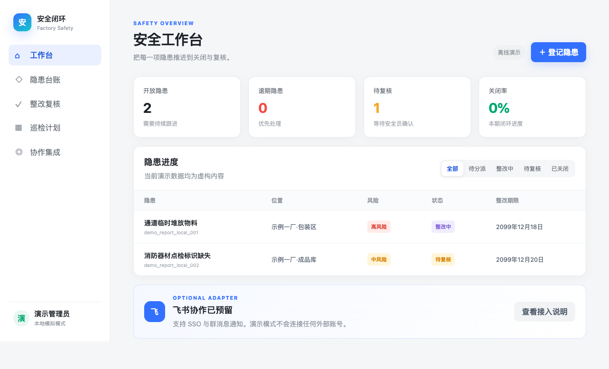
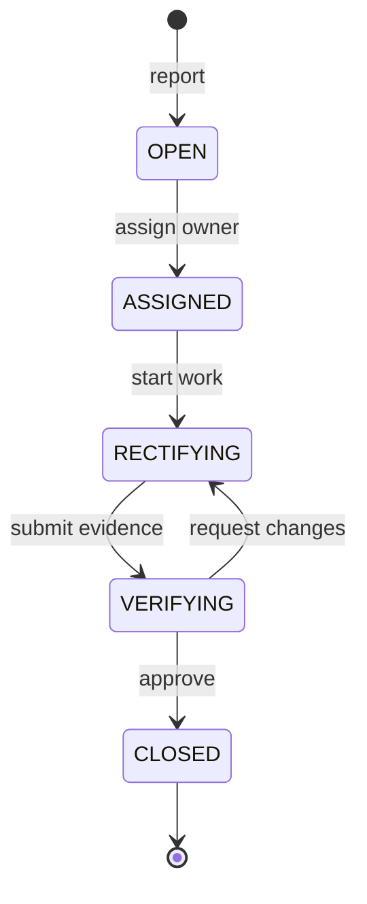
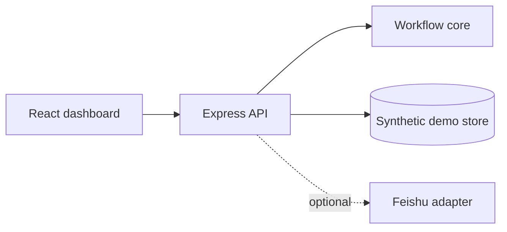

<div align="center">

# Factory Safety Loop

**A privacy-first reference app for closing factory safety hazards—from report to verified resolution.**

[](https://github.com/changhaoting1998-star/factory-safety-loop/actions/workflows/ci.yml)
[](https://nodejs.org/)
[](LICENSE)
[](PRIVACY.md)

[Quick start](#quick-start) · [Workflow](#workflow) · [Feishu integration](#feishu-integration) · [中文说明](#中文说明)

</div>



Factory Safety Loop turns a commonly scattered process—reporting hazards, assigning owners, rectifying problems, verifying results and closing cases—into one small, inspectable workflow. It includes a runnable React dashboard, an Express API, domain rules, tests and an optional Feishu adapter.

The repository is a clean-room reference implementation. Every record is synthetic; no production database, chat history, attachment, log, company configuration or real credential is included.

## Why this project

- **A complete loop, not a form demo.** Status transitions make ownership and verification explicit.
- **Useful without cloud accounts.** Mock mode runs locally and never calls Feishu.
- **Integration stays optional.** Domain rules do not depend on a collaboration platform.
- **Privacy checks travel with the code.** `npm run verify` runs tests and a repository privacy scan.
- **Small enough to learn from.** The monorepo separates the web app, API, domain core and adapter.

## Features

- Hazard registration with location, risk level, description and due date
- State machine: open → assigned → rectifying → verifying → closed
- Dashboard metrics for open, overdue, pending verification and closure rate
- React + Vite dashboard with local fallback data
- Express REST API backed by an in-memory demonstration store
- Optional Feishu SSO and group-notification adapter boundaries
- Synthetic demo fixtures, CI, tests, privacy guidance and threat model

## Quick start

Requirements: Node.js 20.19 or newer.

```bash
git clone https://github.com/changhaoting1998-star/factory-safety-loop.git
cd factory-safety-loop
cp .env.example .env
npm install
npm run dev:api
```

In a second terminal:

```bash
npm run dev:web
```

Open <http://localhost:5173>. The default `FEISHU_MODE=mock` does not access any external service.

## Workflow



## Architecture



```text
apps/web                 React + Vite dashboard
apps/api                 Express HTTP API
packages/core            Hazard state machine and metrics
packages/feishu-adapter  Mock/real integration boundary
data/demo                Synthetic fixtures only
docs                     Integration, privacy and threat-model notes
tests                    Domain and adapter tests
```

## Verification

```bash
npm run verify
npm --workspace @factory-safety/web run build
```

`verify` runs the business-rule tests and privacy scanner. Before a public deployment, also run dependency and license audits, review the code manually and follow [the threat model](docs/THREAT_MODEL.md).

## Feishu integration

Mock mode is the safe default. The adapter exposes integration points for SSO and group notifications without coupling the workflow core to Feishu. See [the integration guide](docs/FEISHU_INTEGRATION.md).

Real App IDs, App Secrets, group IDs and callback URLs belong in the deployment environment and must never be committed. Feishu is a third-party product name; this project is not affiliated with or endorsed by Feishu.

## Privacy and production scope

Read [PRIVACY.md](PRIVACY.md), [the desensitization guide](docs/DESENSITIZATION.md) and [the threat model](docs/THREAT_MODEL.md) before importing organizational data.

This release is a reference app for local evaluation and secondary development. A production deployment still needs durable storage, authentication, RBAC, rate limits, security headers, safe attachment handling, audit-log controls, backups and an organization-specific legal review.

## Roadmap

- [ ] PostgreSQL persistence example
- [ ] Role-based permissions and session hardening
- [ ] Evidence attachment validation
- [ ] Inspection-plan module
- [ ] Feishu message-card examples
- [ ] Docker Compose quick start

## 中文说明

这是一个面向中小工厂的安全隐患闭环管理参考实现，覆盖隐患上报、责任分派、整改、复核和关闭。项目可在纯本地模拟模式运行，也预留了飞书登录与群消息通知适配层。

仓库只含虚构演示数据，不含生产数据库、真实人员、聊天记录、附件、企业配置或凭证。接入真实组织数据前，请先完成合法性评估、权限设计和脱敏检查。

## Contributing

Bug reports, workflow examples, documentation improvements and focused pull requests are welcome. Start with [CONTRIBUTING.md](CONTRIBUTING.md) and report security issues through [SECURITY.md](SECURITY.md).

If this reference saves you time, consider starring the repository—it helps more manufacturing teams find it.

## License

[MIT](LICENSE)
